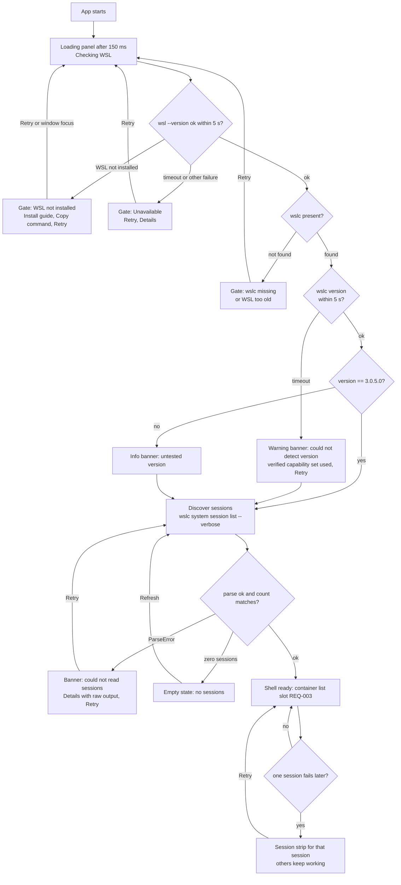

# UX: app shell, availability gate, capabilities and error states (REQ-001, REQ-002, REQ-008)

Tickets: [[REQ-001-discover-runtimes]], [[REQ-002-detect-engine]], [[REQ-008-error-handling]]. Built on [[REQ-000-walking-skeleton]] (one plain table in `<main id="app">`, strings in `src/strings.ts`). Domain and error mapping: [[ba-analysis]] sections 4 and 6. Decisions used: D11, D12, D13, D14 in [[decision-log]]. Tokens and patterns: [[design-system]]. Fixtures: `obsidians/fixtures/session-list-verbose.txt`, `obsidians/fixtures/wsl-version.utf16.txt`, `obsidians/fixtures/errors/wslc-version.txt` and the files listed in `obsidians/fixtures/errors/README.md`. Low-fidelity picture: `obsidians/design/mockups/REQ-001-002-008.html` (not for the app).

Evidence labels follow the tickets: [V] verified on WSL/wslc 3.0.5.0, [R] reported, [U] unverified. A design element marked [U] depends on a fact nobody has observed. "Assumption" means a UX decision or data shape I made that the BA or dev must confirm.

## 1. Summary

This batch turns the REQ-000 bare table into an app shell with four fixed regions (header, notice region, main region, status bar). On startup the app checks WSL, then `wslc`, then sessions, and ends in one of: Available (shell plus the container list slot), or a blocking gate panel (WSL missing, wslc missing, WSL too old, runtime update needed, missing components, unavailable). Non-blocking conditions (untested version, version detection timeout, one failing session) are inline banners or session strips and never stop the rest of the app. All typed errors from REQ-008 are shown by one rule: the failure's scope decides the container (whole app = gate panel, whole list or data = banner, one session = session strip, one user action = toast). Every error message is short and English from `strings.ts`, and the exit code, stderr and `WSLC_E_*` token are only in a "Details" disclosure with a Copy button. Places are reserved for the update banner (REQ-009), the container list (REQ-003) and the live indicator (REQ-006), but they are not designed here.

## 2. User flow



Sub-flow, an error in a user action (REQ-004 will trigger it, the pattern is defined here): action fails -> typed error -> toast (persistent for errors) with a short message, optional action (Refresh list for ContainerNotFound) and Details -> list refreshes by itself when the error means the data is stale (ContainerNotFound, SessionNotFound).

## 3. Screens (wireframes)

Regions and their ids (handoff names, assumption): `app-header`, `app-notices` (contains `slot-update-banner` and `slot-system-notices`), `app-main` (contains `gate-panel` or `slot-list-notices` plus `slot-container-list`), `app-toasts`, `app-statusbar` (contains `slot-live-indicator`).

### 3.1 Available, 800 x 600 (minimum), one session

```
+--------------------------------------------------------------------------------+
| Aiyara Container Dashboard      [Containers]                  [v] Available    |  header 40
+--------------------------------------------------------------------------------+
| (update banner slot REQ-009: empty, takes no space)                            |  notices
+--------------------------------------------------------------------------------+
|                                                                                |
|   [ slot-container-list : REQ-003 designs this. Today: the REQ-000 table ]     |  main
|                                                                                |
|                                                                                |
|                                                                                |
+--------------------------------------------------------------------------------+
| [v] WSLC available | wslc 3.0.5.0 | WSL 3.0.5.0 | 1 session: wslc-cli-<user>... | status 24
+--------------------------------------------------------------------------------+
```

### 3.2 Available, 1280 x 800, untested version, two sessions

```
+------------------------------------------------------------------------------------------------------------+
| Aiyara Container Dashboard      [Containers]                                            [v] Available      |
+------------------------------------------------------------------------------------------------------------+
| (update banner slot REQ-009)                                                                               |
| |i| Untested version  This app was tested with WSL 3.0.5.0. You have 3.0.6.0. Some data may look different.  [Dismiss] |
+------------------------------------------------------------------------------------------------------------+
|  [ slot-container-list : REQ-003 ]                                                                         |
+------------------------------------------------------------------------------------------------------------+
| [v] WSLC available | wslc 3.0.6.0 (untested) | WSL 3.0.6.0 | 2 sessions: default, build                        |
+------------------------------------------------------------------------------------------------------------+
```

Status bar priority when space runs out: availability text, wslc version, session count, WSL version, session names. The untested marker (a word, "untested") stays next to the version as long as the version is shown.

### 3.3 Runtime panel (opened from the header chip, Ctrl+I)

```
                                          +--------------------------------------+
                                          | Runtime                          [x] |
                                          | STATUS                               |
                                          | [v] Available                        |
                                          | VERSIONS                             |
                                          | WSL     3.0.5.0                      |
                                          | wslc    3.0.5.0   Tested version     |
                                          | SESSIONS (1)                         |
                                          | wslc-cli-<user>  ID 1  PID 40580     |
                                          | CAPABILITIES                         |
                                          | [v] List containers      Verified    |
                                          | [v] Stats snapshot       Verified    |
                                          | [v] Inspect              Verified    |
                                          | [v] Live events          Verified    |
                                          | [v] Follow logs          Verified    |
                                          | [v] Restart              Verified    |
                                          | [v] Per-session commands Verified    |
                                          |                  [ Retry detection ] |
                                          +--------------------------------------+
```

On a version other than 3.0.5.0 the right-hand column says "Assumed" instead of "Verified" and the versions block says "Untested version". Capability rows come from the data (one row per capability the backend reports), with a label from `strings.ts` keyed by capability id and the raw id as the fallback for an unknown key.

### 3.4 Gate: wslc missing (also the template for the other gates), 800 x 600

```
+--------------------------------------------------------------------------------+
| Aiyara Container Dashboard      [Containers]                [x] Not available  |
+--------------------------------------------------------------------------------+
|                                                                                |
|      [!]  wslc was not found                                                   |
|                                                                                |
|      WSL is installed, but wslc.exe was not found. Your WSL version may be     |
|      too old for containers. Update WSL, then select Retry.                    |
|                                                                                |
|      To update, run this command in a terminal:                                |
|      +-----------------------------+                                           |
|      | wsl --update               |  [ Copy command ]                          |
|      +-----------------------------+                                           |
|                                                                                |
|      [ Retry ]                                                                 |
|                                                                                |
|      > Details                                                                 |
|                                                                                |
+--------------------------------------------------------------------------------+
| [x] WSLC not available | WSL 3.0.5.0 | wslc not found | Sessions unavailable   |
+--------------------------------------------------------------------------------+
```

When REQ-009 ships, the "run this command" block is replaced by an "Update WSL..." button that opens the REQ-009 flow (reserved slot `gate-update-action`). Until then the copy-command hint is the only pointer, because the ticket demands "a pointer to the update flow in REQ-009".

### 3.5 Partial: one session failed, untested version, details open, 1280 wide

```
+------------------------------------------------------------------------------------------------------------+
| Aiyara Container Dashboard      [Containers]                                       [!] Untested version    |
+------------------------------------------------------------------------------------------------------------+
| |i| Untested version ... [Dismiss]                                                                         |
+------------------------------------------------------------------------------------------------------------+
| |x| [build] Session "build" no longer exists.   [ Refresh sessions ]  v Details                           |
|     Error type  SessionNotFound        Error code  WSLC_E_SESSION_NOT_FOUND     Exit code  1               |
|     Output from wslc:  Session not found: 'build' ...                          [ Copy details ]            |
| Name        Image        State        Status          Session                                              |
| web         alpine       Running      Up 3 seconds    default        <- rows of working sessions stay      |
+------------------------------------------------------------------------------------------------------------+
| [!] WSLC available | wslc 3.0.6.0 (untested) | WSL 3.0.6.0 | 2 sessions, 1 with errors                       |
+------------------------------------------------------------------------------------------------------------+
```

### 3.6 Empty and loading

- Zero sessions (shown only if the BA confirms that 0 sessions is a success, [U]): empty state in the main region, "No WSLC sessions found".
- Loading panel (after 150 ms): three lines, "Checking WSL...", "Checking wslc...", "Looking for sessions...", current line with a spinner. At 3 s a muted line appears: "Still checking. This can take a few seconds." At 5 s the step times out (typed Timeout).

## 4. Component list

| Component | Defined in | Used for |
|---|---|---|
| App shell (header, notice region, main, status bar, toast region) | this doc, [[design-system]] 6 | all screens |
| Nav tabs | 4.1 below | one tab "Containers" now, reserved for later tabs |
| Status chip + Runtime panel | design-system 5.1, 5.8 | versions, sessions summary, capabilities |
| Status bar | design-system 5.2 | availability, versions, sessions, live slot |
| Banner (error, warning, info) | design-system 5.3 | untested version, version timeout, parse error, list failure |
| Session strip | design-system 5.4 | one failing session |
| Gate panel | design-system 5.5 | six blocking availability states |
| Toast | design-system 5.6 | one-action failures (wired in REQ-004) |
| Details disclosure + Copy details | design-system 5.9 | all errors |
| Disabled control with reason | design-system 5.10 | capability-false controls, actions while WSLC is unavailable |
| Busy button | design-system 5.11 | Retry |
| Empty state | design-system 5.7 | no sessions |
| Loading panel | design-system 5.12 | startup |

### 4.1 Navigation placeholder
A `<nav aria-label="Primary">` with a tab strip (`role` not needed, use links/buttons with `aria-current="page"`). Only "Containers" exists. Later tickets append tabs (Sessions in REQ-010) and a gear button at the right of the header (Settings, REQ-009) without a layout change. I deliberately do not render disabled "coming soon" tabs: they would be controls that cannot work, which contradicts the ticket intent of never offering something that cannot be done. Top tabs rather than a left rail: saves 48 px of width at 800 px and keeps the table wide.

## 5. States table

| Surface | State | What the user sees | Source / evidence |
|---|---|---|---|
| Startup | Loading under 150 ms | Nothing extra (avoid flicker) | design |
| Startup | Loading | Loading panel with 3 steps, status bar "Checking..." | REQ-001 AC1 |
| Startup | Slow (3 s) | "Still checking" line | REQ-001 AC1 (3 s target) |
| Availability | Available | Header chip "Available", status bar facts, container slot | REQ-001 AC2 |
| Availability | WslNotInstalled | Gate: install guide, copy `wsl --install`, Retry | AC4 [U how detected] |
| Availability | WslcMissing | Gate: wslc not found, update hint, Retry | AC3 [U] |
| Availability | WslTooOld | Gate: WSL too old, update hint, Retry | AC8 [U: floor unverified, see Q2] |
| Availability | RuntimeUpdateNeeded | Gate: runtime needs update, update hint, Retry | token `WSLC_E_RUNTIME_UPDATE_NEEDED` is [R], not observed; not in the ticket enum (Q1) |
| Availability | MissingComponents | Gate: components missing, update or repair hint, Retry | not in the ticket enum and no evidence at all [U] (Q1) |
| Availability | Unavailable | Gate: generic, Retry, Details | AC8 |
| Version | Untested (not 3.0.5.0) | Info banner plus "(untested)" in status bar and panel | REQ-001 AC7, REQ-002 AC2 [U] |
| Version | Detection timeout | Warning banner "Could not detect the WSL version", status "Version unknown", verified set used, Retry | REQ-002 AC5 |
| Sessions | Parsed | Count and names in status bar, list in panel | REQ-001 AC5 |
| Sessions | Zero sessions | Empty state | [U] (Q4) |
| Sessions | ParseError (count mismatch) | Error banner, Details with raw output, Retry | REQ-001 AC5 |
| Sessions | One session fails | Session strip for that session, other rows stay | REQ-008 AC13 |
| List | Load timeout or failure | Error banner above the list, last good rows stay with "Showing the last known data" | assumption (stale data kept) |
| Action | Long-running (stop/restart about 10 s [V]) | Busy button pattern, repeat clicks ignored (applied by REQ-004) | ba-analysis section 4 |
| Action | Failure | Persistent error toast with Details | REQ-008 |
| Offline (network) | No network | Nothing shown, nothing changes. The only network feature is REQ-009 and it fails silently | REQ-008 AC16 |
| WSL missing | see Availability | | |
| Controls | WSLC not available | All container action controls (later tickets) use disabled-with-reason | REQ-002 AC4 |
| Destructive confirm | Not in this batch | REQ-007 | out of scope |

## 6. Interactions and shortcuts

Shortcuts are registered once, in one place, and each also has a visible button (no shortcut-only features).

| Key | Action | Notes |
|---|---|---|
| Tab / Shift+Tab | Move focus in visual order | Skip link first |
| F6 / Shift+F6 | Cycle regions: header, notices, main, status bar | Windows convention for panes |
| F5 or Ctrl+R | Refresh: re-run detection and discovery (same as Retry) | Assumption. Ignored while already running |
| Ctrl+I | Open or close the Runtime panel | Assumption (not used by the webview) |
| Esc | Close Runtime panel or tooltip, dismiss focused toast | Focus returns to the trigger |
| Ctrl+1 | Go to Containers | Reserved pattern, Ctrl+2... for later tabs |
| Enter / Space | Activate buttons, toggle Details | Native |

Behaviour rules
- Retry (gate, banner, strip) re-runs only what failed: gate Retry re-runs the whole detection; a session strip Retry re-lists that session only; the sessions banner Retry re-runs session discovery. While running the button is busy (design-system 5.11) and ignores repeat clicks. Detection has the 5 s timeout, so a retry can never hang the UI longer than that.
- No automatic retry loops in this batch. Option for the owner: re-run detection once when the window regains focus while a gate is shown (useful right after installing or updating WSL), at most once per 5 s. Default proposed: ON for gates only. See Owner decisions.
- Untested-version "Dismiss" hides the banner for the current run only (nothing persisted, settings are REQ-009). The status bar marker stays, so the information is never lost.
- Copy details copies a plain-text block to the clipboard and shows "Details copied" in the button for 2 s (announced with `role="status"`).
- Install guide opens in the default browser through the OS (not a network call by the UI). The command copy alternative exists so the flow also works without any link (see Q11).
- A focus move: when a gate panel replaces the loading panel, focus goes to its primary button, so Enter retries. When a banner appears, focus does not move (it is announced via its live role) except for gate panels.

### Error presentation matrix (REQ-008)

| Rule | Scope of the failure | Presentation |
|---|---|---|
| 1 | The app cannot use WSLC at all | Gate panel in the main region, header chip "Not available" |
| 2 | Whole data set (session discovery, list for all sessions) | Banner above the content, last good data kept and marked stale |
| 3 | One session | Session strip above the list |
| 4 | One user action | Toast (error toasts persist) |
| 5 | A bug in our own command | Banner (listing) or toast (action) with Copy details emphasised |

| Typed error | Where | Message key | Primary action | Details content |
|---|---|---|---|---|
| WslMissing | Gate | gate.wslNotInstalled | Open install guide, Copy command, Retry | exit code or spawn error if present |
| WslcMissing | Gate | gate.wslcMissing | Update hint, Retry | as above |
| PermissionDenied | Gate if at startup, toast if in an action | error.permissionDenied | Retry | exit code, stderr (no fixture, [U]) |
| Timeout | Version: warning banner. List: banner. Action: toast | error.timeout (variants for version, list, action) | Retry (Refresh for action) | Error type, timeout seconds if provided |
| ParseError | Banner (sessions or list) or strip | error.parseError | Retry | Raw output, expected vs found session count if provided |
| RuntimeUnavailable | Gate (Unavailable layout) or banner | error.runtimeUnavailable | Retry | exit code, stderr |
| UnsupportedOperation | Prevented by disabled-with-reason, toast if it still happens | error.unsupportedOperation | none | exit code, stderr |
| SessionNotFound | Session strip, toast in an action | error.sessionNotFound | Refresh sessions | Code `WSLC_E_SESSION_NOT_FOUND`, exit code 1, stderr |
| ContainerNotFound | Toast, list auto-refreshes | error.containerNotFound | Refresh list | Code `WSLC_E_CONTAINER_NOT_FOUND` (or "no code, empty [] from inspect"), exit code 1, stderr (may be empty) |
| ImageNotFound | Toast | error.imageNotFound | none | Code `WSLC_E_IMAGE_NOT_FOUND`, stderr |
| InternalError | Banner or toast | error.internal | Copy details | Exit code, full usage text as stderr |
| CommandFailed | Toast, strip or banner | error.commandFailed | Retry only where the operation is a read (list); none for actions | The `WSLC_E_*` token (if any), exit code, stderr |

Details layout (all errors): a `<dl>` with only the rows that exist (Error type, Error code, Exit code, Session) then "Output from wslc" in a `<pre>`; empty stderr shows "(empty)" in muted text (fixture `container-stats-missing.txt` has just a blank line plus the code line). A note under it: "Details can include your Windows user name and file paths. Review them before sharing." The message above never contains any of these values. UI code decides nothing from stderr text: it only displays it.

## 7. Copy (key and text, ready for `src/strings.ts`)

Placeholders in braces are filled by one formatting helper. Existing keys in `strings.ts` that stay: `appTitle`, `loading`, `empty`, `columns.*`, `states.*`, `errors.generic`. Existing `errors.parseError`, `errors.commandFailed`, `errors.timeout`, `errors.internal` are replaced by the `error.*` keys below (they are less specific and name no next step).

### 7.1 Shell and navigation

| Key | Text | Where used |
|---|---|---|
| shell.skipToMain | Skip to main content | Skip link |
| shell.noticesLabel | Notices | Notice region aria-label |
| shell.toastsLabel | Notifications | Toast region aria-label |
| nav.label | Primary | Nav aria-label |
| nav.containers | Containers | Tab |
| header.runtimeButtonLabel | Runtime details | aria-label of the chip (shortcut hint in tooltip) |
| header.runtimeTooltip | Runtime details (Ctrl+I) | Tooltip |

### 7.2 Loading and status bar

| Key | Text | Where used |
|---|---|---|
| status.checkingWsl | Checking WSL... | Loading step 1, status bar |
| status.checkingWslc | Checking wslc... | Loading step 2 |
| status.checkingSessions | Looking for sessions... | Loading step 3 |
| status.stillChecking | Still checking. This can take a few seconds. | After 3 s |
| status.available | WSLC available | Status bar, chip text "Available" uses status.chipAvailable |
| status.chipAvailable | Available | Header chip |
| status.chipNotAvailable | Not available | Header chip |
| status.chipUntested | Untested version | Header chip when available but untested |
| status.chipChecking | Checking... | Header chip while loading |
| status.notAvailable | WSLC not available | Status bar |
| status.wslVersion | WSL {version} | Status bar |
| status.wslcVersion | wslc {version} | Status bar |
| status.wslcVersionUntested | wslc {version} (untested) | Status bar |
| status.wslcNotFound | wslc not found | Status bar |
| status.versionUnknown | Version unknown | Status bar |
| status.sessionsOne | 1 session | Status bar |
| status.sessionsMany | {count} sessions | Status bar |
| status.sessionsNames | {count} sessions: {names} | Status bar, wide |
| status.sessionsWithErrors | {count} sessions, {failed} with errors | Status bar |
| status.sessionsUnavailable | Sessions unavailable | Status bar when gated |

### 7.3 Gate panels (REQ-001 AC8, REQ-008 AC9)

| Key | Text | Where used |
|---|---|---|
| gate.wslNotInstalled.title | WSL is not installed | Gate title |
| gate.wslNotInstalled.body | WSL containers need Windows Subsystem for Linux. Install it, then select Retry. | Gate |
| gate.wslNotInstalled.guide | Open install guide | Button (link) |
| gate.wslNotInstalled.command | wsl --install | Command shown, Copy command copies it [U: standard command, not run by us] |
| gate.wslcMissing.title | wslc was not found | Gate title |
| gate.wslcMissing.body | WSL is installed, but wslc.exe was not found. Your WSL version may be too old for containers. Update WSL, then select Retry. | Gate |
| gate.wslTooOld.title | WSL is too old for containers | Gate title |
| gate.wslTooOld.body | WSL {version} does not support containers. Update WSL, then select Retry. | Gate |
| gate.wslTooOld.bodyNoVersion | The installed WSL does not support containers. Update WSL, then select Retry. | Gate when the version is unknown |
| gate.runtimeUpdateNeeded.title | WSL needs an update to run containers | Gate title [R] |
| gate.runtimeUpdateNeeded.body | WSL reported that its container runtime must be updated first. Update WSL, then select Retry. | Gate [R] |
| gate.missingComponents.title | Some WSL components are missing | Gate title [U] |
| gate.missingComponents.body | WSL is installed, but components that containers need are missing. Update or repair WSL, then select Retry. | Gate [U] |
| gate.unavailable.title | WSL containers are not available | Gate title |
| gate.unavailable.body | The app could not use WSL containers on this PC. Select Retry, or open Details to see what WSL reported. | Gate |
| gate.updateHint | To update, run this command in a terminal: | Above the command (until REQ-009) |
| gate.updateCommand | wsl --update | Command shown (not run by the app) |
| gate.updateAction | Update WSL... | Reserved for REQ-009 (not rendered in this batch) |

### 7.4 Notices (banners)

| Key | Text | Where used |
|---|---|---|
| notice.untested.title | Untested version | Info banner |
| notice.untested.body | This app was tested with WSL {tested}. You have {version}. Most things should work, but some data may look different. | Info banner [U] |
| notice.versionTimeout.title | Could not detect the WSL version | Warning banner |
| notice.versionTimeout.body | The version check took too long, so only features verified on WSL {tested} are enabled. | Warning banner |
| notice.sessionsParse.title | Could not read the session list | Error banner |
| notice.sessionsParse.body | wslc returned a session list in a shape the app does not understand. Select Retry, or copy the details if it keeps happening. | Error banner |
| notice.stale | Showing the last known data. | Under an error banner with stale rows |
| notice.moreNotices | {count} more notices | Collapsed overflow row |

### 7.5 Typed errors (primary messages)

Each has `.title` (bold, short) and `.body` (one or two sentences, a next step). Only these strings are shown outside Details.

| Key | Text | Where used |
|---|---|---|
| error.wslMissing.title / .body | WSL is not installed / Install WSL, then select Retry. | Fallback if raised outside the gate |
| error.wslcMissing.title / .body | wslc was not found / Update WSL, then select Retry. | Fallback |
| error.permissionDenied.title | Access was denied | Toast, banner [U] |
| error.permissionDenied.body | Windows did not let the app use WSL containers. Check that your Windows user can run wslc, then retry. | [U] no fixture |
| error.timeout.title | WSL did not respond in time | Banner (list) |
| error.timeout.body | The command was stopped after {seconds} s. Select Retry. | Banner |
| error.timeoutAction.title | The action took too long | Toast |
| error.timeoutAction.body | The command was stopped after {seconds} s. The container may still be changing state. Refresh the list to see where it is. | Toast |
| error.parseError.title | The output could not be read | Banner, strip |
| error.parseError.body | wslc returned output in a shape the app does not understand. This can happen on a WSL version the app has not been tested with. | Banner |
| error.runtimeUnavailable.title | The container runtime is not reachable | Banner or gate |
| error.runtimeUnavailable.body | WSL is installed but the container runtime did not answer. Select Retry. | Banner or gate |
| error.unsupportedOperation.title | Not supported by your WSL version | Toast |
| error.unsupportedOperation.body | This action needs a newer WSL. See Runtime for your version. | Toast |
| error.sessionNotFound.title | Session {session} no longer exists | Strip, toast |
| error.sessionNotFound.body | It may have ended. Refresh the sessions to update the list. | Strip |
| error.containerNotFound.title | {name} no longer exists | Toast |
| error.containerNotFound.body | It was probably removed outside the app. The list is being refreshed. | Toast |
| error.imageNotFound.title | Image {image} was not found | Toast |
| error.imageNotFound.body | Check the image name, or pull it first. | Toast |
| error.internal.title | The app sent a command WSL did not accept | Banner, toast |
| error.internal.body | This is a bug in the app, not in your setup. Copy the details and include them in a bug report. | Banner, toast |
| error.commandFailed.title | The command did not complete | Toast, strip, banner |
| error.commandFailed.body | WSL reported an error. Open Details to see what it said. | Toast, strip, banner |
| errors.generic | Something went wrong. | Existing key, last resort for an unknown error kind |

### 7.6 Actions, details, capabilities, sessions, empty states

| Key | Text | Where used |
|---|---|---|
| action.retry | Retry | Gate, banner, strip |
| action.retrying | Retrying... | Busy button |
| action.stillWorking | Still working... | After 3 s of busy |
| action.refresh | Refresh | Generic refresh |
| action.refreshList | Refresh list | ContainerNotFound toast |
| action.refreshSessions | Refresh sessions | Session strip |
| action.dismiss | Dismiss | Banner, toast |
| action.copyCommand | Copy command | Gate |
| action.copied | Copied | Button state, 2 s |
| action.copyDetails | Copy details | Details |
| action.detailsCopied | Details copied | Button state, 2 s, live region |
| details.summary | Details | Disclosure summary |
| details.errorType | Error type | Details row |
| details.errorCode | Error code | Details row (the `WSLC_E_*` token) |
| details.exitCode | Exit code | Details row |
| details.session | Session | Details row |
| details.output | Output from wslc | Details heading for stderr or raw output |
| details.empty | (empty) | Empty stderr |
| details.privacy | Details can include your Windows user name and file paths. Review them before sharing. | Under details |
| runtime.title | Runtime | Panel title |
| runtime.close | Close | Panel close button aria-label |
| runtime.status | Status | Section |
| runtime.versions | Versions | Section |
| runtime.wsl | WSL | Row label |
| runtime.wslc | wslc | Row label |
| runtime.tested | Tested version | Badge |
| runtime.untested | Untested version | Badge |
| runtime.unknown | Unknown | Value when undetected |
| runtime.sessions | Sessions | Section |
| runtime.sessionId | ID {id} | Session row |
| runtime.sessionPid | PID {pid} | Session row (Creator PID) |
| runtime.sessionDefault | default | Badge (D12, see Q3) |
| runtime.sessionsNote | Sessions belong to the current Windows user. Other users' sessions are not shown. | Under the list [R per ba-analysis risks] |
| runtime.capabilities | Capabilities | Section |
| runtime.capVerified | Verified | Column, version 3.0.5.0 |
| runtime.capAssumed | Assumed | Column, other versions |
| runtime.capOn | Available | Row state |
| runtime.capOff | Unavailable | Row state |
| runtime.recheck | Retry detection | Panel button |
| capability.list | List containers | Row label |
| capability.statsSnapshot | Stats snapshot | Row label |
| capability.inspect | Inspect | Row label |
| capability.events | Live events | Row label |
| capability.logsFollow | Follow logs | Row label |
| capability.restart | Restart | Row label |
| capability.session | Per-session commands | Row label (`--session`) |
| capability.reasonVersion | Requires WSL {required} or later. You have {version}. | Disabled-control tooltip |
| capability.reasonUnavailable | WSLC is not available. See Runtime. | Disabled-control tooltip when gated |
| capability.reasonUnsupported | Not supported by your WSL version. | Fallback tooltip |
| empty.noSessions.title | No WSLC sessions found | Empty state [U] |
| empty.noSessions.body | Sessions appear after you run a container with wslc. Run one in a terminal, then select Refresh. | Empty state [U] |
| empty.noContainers | No containers. | Owned by REQ-003 (existing key `empty`) |

## 8. Accessibility

- Focus order: skip link, nav tab, runtime chip, notice region (banner actions left to right), main region (gate primary action, then secondary, then Details), status bar is not focusable. The Runtime panel opens right after the chip in tab order and returns focus to the chip on Esc.
- Landmarks: `header`, `nav`, `section aria-label="Notices"`, `main`, `footer role="status"`. One `h1` (the gate title or the "Containers" heading of REQ-000), panel titles are `h2`.
- Live regions: errors `role="alert"` (assertive), warnings and info `role="status"`. The status bar updates only when state changes. A busy Retry sets `aria-busy="true"`.
- Names: icon-only buttons (Dismiss, Close, runtime chip when narrow) carry `aria-label` from strings. Icons are `aria-hidden`.
- Not colour only: Available has a check, Not available an x badge, untested a triangle, info an i; each is paired with the words shown. Capability rows use "Available/Unavailable" text. Session strips name the session in text.
- Contrast: tokens in [[design-system]] (hand computed, tester to re-verify). The state colour is limited to icon, border and title.
- Reduced motion: spinner static, no translate or height animations; text still says "Retrying...".
- Details and raw output: real text in `<pre>`, selectable, wraps at 200% zoom, scrolls inside its own box with `tabindex="0"` and `aria-label="Output from wslc"` so keyboard users can scroll it.
- Tooltips: appear on focus as well as hover, Esc closes, text also referenced by `aria-describedby`.
- Forced colours and dark mode: both supported, see design system 9.
- Error text is never truncated; only the session badge and status bar truncate (with full text in a tooltip and in the panel).

## 9. Acceptance-criteria traceability

### REQ-001

| Criterion | Element that satisfies it |
|---|---|
| WSL version from `wsl --version` shown within 3 s, UTF-16LE decoded without NUL | Status bar "WSL {version}", Runtime panel Versions row, loading panel step 1 with "Still checking" at 3 s. Decoding is backend. UI check: the shown string contains no NUL (tester) |
| `wslc.exe` present: version shown, WSLC marked Available | Header chip "Available", status bar "WSLC available" + "wslc 3.0.5.0", Runtime panel |
| `wslc.exe` not found: "not available" with hint and a pointer to the REQ-009 update flow, no crash | Gate `gate.wslcMissing` with update hint and reserved `gate-update-action` slot, header chip "Not available", status bar "wslc not found". No-crash: the gate is a normal state, not an exception path; unknown errors fall to `Unavailable` gate |
| WSL not installed: message with install link, no crash | Gate `gate.wslNotInstalled`: "Open install guide" link plus "Copy command" |
| Sessions from `system session list --verbose` parsed to ID, Creator PID, Display Name; count line must match, else ParseError with raw output in details | Runtime panel Sessions list (name, ID, PID), status bar count and names, `notice.sessionsParse` banner with Details (raw output in `<pre>`) |
| Default session shown as "default" with named sessions (D12, [U] on a clean machine) | `runtime.sessionDefault` badge in the Sessions list, status bar names. How the default is identified is not in the data: Q3 |
| Version other than 3.0.5.0: non-blocking untested notice [U] | `notice.untested` info banner (dismissible), "(untested)" in status bar, "Untested version" badge in panel, header chip text |
| Result is one of Available, WslNotInstalled, WslcMissing, WslTooOld, Unavailable, each with an English message from the string module | Five states = header chip + gate title/body keys `gate.*` and `status.*`. Two extra gates are designed (RuntimeUpdateNeeded, MissingComponents) pending Q1 |

### REQ-002

| Criterion | Element that satisfies it |
|---|---|
| 3.0.5.0: Capabilities equal the verified set (list, stats snapshot, inspect, events, logs follow, restart, `--session`) | Runtime panel Capabilities: seven rows, all "Available", column "Verified" |
| Other version: verified set only and untested notice [U] | Same seven rows, column "Assumed", plus `notice.untested` |
| Features beyond MVP disabled below their gate (loopback >= 3.0.5, network connect/disconnect >= 3.1.0 [R]); never a hard-coded floor | Disabled-with-reason pattern (design-system 5.10) with `capability.reasonVersion`. No beyond-MVP control exists in this batch, so this is a defined pattern, not a visible element, and cannot be checked visually yet (Q5). The UI reads capabilities from data and never compares version numbers itself |
| Capability false: control disabled with tooltip, not hidden silently | Pattern 5.10, and in this batch all container action controls added later use `capability.reasonUnavailable` when WSLC is gated. Capability rows in the panel show "Unavailable" text instead of vanishing |
| Version undetermined within 5 s: "could not detect" with typed Timeout, verified set used | `notice.versionTimeout` warning banner, status "Version unknown", panel shows "Unknown", Details with Error type Timeout, Retry |
| `Capabilities` part of the `EngineConnector` trait | Backend only. UI consequence: capability rows are data-driven, label by key with raw key as fallback |

### REQ-008

| Criterion | Element that satisfies it |
|---|---|
| Any failure maps to one of 12 typed errors | Error presentation matrix section 6: every type has a place and a `error.*` key |
| Exit 0 is success even if nothing changed | No error UI is shown on success, including idempotent stop (no toast of any kind for a no-op) |
| Exit 1 + `Error code:` with CONTAINER/SESSION/IMAGE_NOT_FOUND maps to the three typed errors | `error.containerNotFound`, `error.sessionNotFound`, `error.imageNotFound`, token in Details only |
| Other `WSLC_E_*` token: CommandFailed with token in details | `error.commandFailed` + Details row "Error code" |
| Decide by exit code and token only, never English text, message from the string module | UI never reads stderr to decide anything; the primary message is always a `strings.ts` key; stderr only goes into the Details `<pre>` |
| `container stats <missing>` (blank line + code only) still maps | Same ContainerNotFound toast; Details shows "(empty)" for the missing message |
| `container inspect <missing>` (exit 1, `[]`, no code line) maps to ContainerNotFound | Same toast; the "Error code" row is omitted when no token exists |
| Usage error maps to InternalError, raw stderr in details | `error.internal` banner or toast, usage text in the Details `<pre>`, Copy details emphasised |
| WSL or wslc missing or too old: matching action (install link or REQ-009 flow) and Retry [U] | Gate panels (install guide, update hint, Retry) |
| Short message; raw stderr and exit code in details expander, never main text | Banner/toast/gate anatomy: message block then closed `<details>` |
| ParseError with raw output in details | `error.parseError` / `notice.sessionsParse`, raw output in Details |
| Unknown JSON keys ignored, missing keys empty, not a failure [U] | No error UI. Rule for REQ-003: a missing value renders as an empty cell, not as an error |
| One session fails, others keep working, failed one shows its own error | Session strip per failed session above the list |
| Timeout kills process and shows Timeout (5 s read, 30 s or more stop/restart) | `error.timeout` banner (reads) and `error.timeoutAction` toast with the seconds, plus the Refresh hint |
| All error text from the string module | Section 7: no literals in code |
| Offline from the network: nothing but the update check affected | No offline indicator or message is designed on purpose. REQ-009 owns the (silent) failure handling |

## 10. Open questions for the BA

Q1. REQ-001 lists five states (Available, WslNotInstalled, WslcMissing, WslTooOld, Unavailable) and REQ-008 lists 12 error types. "MissingComponents" and "RuntimeUpdateNeeded" are in neither. The only trace is the token `WSLC_E_RUNTIME_UPDATE_NEEDED` [R, not observed]. Should they become availability states (my design assumes yes, same gate template, both marked [R]/[U]), or fold into Unavailable and CommandFailed? What evidence exists for "missing components"?
Q2. How is WslTooOld decided? REQ-002 forbids a hard-coded version floor and the floor is [U], so the only signals are `wslc.exe` missing or a runtime-update token. Then WslTooOld and WslcMissing cannot be told apart. Proposal: show WslTooOld only if a version was read and a backend-supplied rule says so; otherwise show WslcMissing (whose copy already says the WSL version may be too old).
Q3. How is the default session identified? The only fixture shows one session with Display Name `wslc-cli-<user>` and no "default". Is "default" a label we derive (for example the session with the CLI default name), or a literal display name? Is a default session present on a clean machine [U]?
Q4. Is 0 sessions a success (Available with an empty state) or an error? Does `session list` with 0 sessions print `[wslc] Found 0 sessions` and no table [U]? Plural/singular text of the count line with N>1 is also unobserved.
Q5. Which version drives capabilities and the untested notice: `wsl --version` (WSL package) or `wslc version`? Both read 3.0.5.0 now. If they can differ, what is "untested": either one, or both? Also `wsl --version` prints several lines (kernel, WSLg, MSRDC...): the design shows only the "WSL version" value. Also: in this batch no MVP control can actually be disabled by a version gate, because the MVP set is fixed. Confirm that REQ-002 is satisfied by the panel plus the pattern and that visual verification of the gated-control tooltip is deferred to the first ticket that has such a control.
Q6. Which error payload will the Tauri command return? The current `AppError` in `src/main.ts` has only `kind`. The design needs, per error: `kind` (the 12), optional `code` (the `WSLC_E_*` token), `exit_code`, `stderr` or raw output, `session` (name, for session-scoped errors), and for ParseError the expected and found counts. These are proposed fields (assumption), none exists yet. Should the command line be included in details (useful, but may include container names and user paths)?
Q7. Untested-version dismissal: for this run only (design), per version (needs a setting), or never dismissible? Settings only arrive with REQ-009.
Q8. PermissionDenied has no fixture and no detection rule [U]. Is the copy provisional, and what triggers it?
Q9. Session discovery with N sessions and a 5 s timeout each: sequential or parallel, and are partial results shown as they arrive? Design assumes progressive rendering (each session reports independently).
Q10. Stale data: when a refresh fails after a success, should the last rows stay visible (design assumption, marked "Showing the last known data") or be cleared?
Q11. Install guide link: which URL, and is opening an external page allowed by the security model (it is an OS handoff, not a UI network call, but needs a Tauri capability)? Candidate: Microsoft Learn WSL install page [R, from general knowledge, not verified here].
Q12. Is `wsl --install` the right command to show (standard Microsoft command, not verified on this machine and not run by the app)? It is only a copy-to-clipboard text.

## 11. Owner decisions at review

1. Shell layout: top tab strip, status bar with facts, one Runtime panel (not a left rail). Approve or ask for a rail.
2. Re-check on window focus while a gate is shown (at most once per 5 s). Proposed ON for gates. Approve or drop.
3. Install guide link and the `wsl --install` / `wsl --update` copy-command hints (no command is ever run by this batch).
4. Toast: recommended to build the component with REQ-004 (first real trigger) and not now, to avoid dead code. Spec is ready either way.
5. Icon source: Segoe Fluent Icons (system font, Windows 11 only per D14). Alternative: inline SVG set (more code, no font dependency).
6. Keyboard shortcuts F5/Ctrl+R, Ctrl+I, F6.
7. Whether to include the two extra gate states (RuntimeUpdateNeeded, MissingComponents) before the BA answers Q1. Cheap to build (same template), low evidence.

## 12. Handoff notes for dev (no code)

What changes at a high level

`index.html`
- Replace the single `<main id="app">` with the landmark structure: skip link, `header#app-header` (brand, `nav`, runtime chip button), `section#app-notices` (aria-label Notices) with `#slot-update-banner` and `#slot-system-notices`, `main#app-main` (contains `#slot-list-notices` and the existing `#app` container-list mount, which becomes `#slot-container-list`), `div#app-toasts` (live region), `footer#app-statusbar` with `#slot-live-indicator`.
- Add one stylesheet (for example `src/styles.css`, bundled by Vite, no inline `<style>` and no `style=""` attributes, CSP-safe). Keep `<html lang="en">`. Set the document title from strings as today.
- No new scripts, no external resources.

`src/styles.css` (new): the tokens from [[design-system]] section 1, layout grid (header, scrolling main, status bar), the component classes, `prefers-color-scheme`, `prefers-reduced-motion` and `forced-colors` blocks. `color-scheme: light dark`.

`src/main.ts` (high level; split into small modules as dev sees fit)
- App state: one object holding availability (the six states plus loading), versions, tested flag, sessions list, capabilities, per-session errors, global notices. Rendering reads state; actions mutate it.
- Startup sequence: call the availability/session commands, drive the loading panel (150 ms delay, 3 s hint), render the gate or the shell.
- Error presenter: one function mapping an error value (typed kind plus optional code, exit code, output, session) to presentation (gate, banner, strip, toast), a message key, an action and details rows, exactly as the matrix in section 6. Replaces the current `errorText` switch. Unknown kinds fall back to `errors.generic`.
- Components as plain DOM builders using `textContent` only: banner, session strip, gate panel, details disclosure with Copy (uses the clipboard API, no network), runtime panel (popover with focus return), status bar, busy button, disabled-with-reason control with tooltip.
- Global keyboard handler registered once (F5/Ctrl+R, Ctrl+I, F6, Esc, Ctrl+1).
- Keep the REQ-000 table rendering as the content of `#slot-container-list` until REQ-003 replaces it. It must keep working inside the new layout.
- Ignore repeat Retry clicks while a request is in flight. Do not poll or auto-retry in this batch, except the optional single focus-triggered re-check.

`src/strings.ts`
- Add the keys of section 7, grouped as nested objects (`shell`, `nav`, `status`, `gate`, `notice`, `error`, `action`, `details`, `runtime`, `capability`, `empty`). Replace `errors.parseError`, `errors.commandFailed`, `errors.timeout`, `errors.internal` by the `error.*` set. Add a tiny `format(template, vars)` helper (templates use `{name}`) next to the strings, since `as const` plain strings cannot interpolate.
- No UI text anywhere else, including aria-labels and tooltips.

Data the UI needs (proposed contract, assumption, none of this exists yet): availability state; WSL version string; wslc version string; `tested` flag or the tested version string; sessions as name, ID, creator PID and a default flag [U, Q3]; capabilities as a list of key plus boolean (and optional required version for the tooltip); per-session error; typed error with the fields in Q6. Values stay display strings, nothing is parsed in the UI beyond showing it.

Native vs custom
- Native: `<details>` for Details, `<button>`, `<a>` for the install guide, `<dl>`, `<pre>`. Custom: popover (Runtime panel), tooltip for disabled controls, toast manager, banner stack with overflow row, loading panel.

Performance and robustness notes
- Nothing here is a long list: no virtualisation needed for sessions (expected count is single digits). The container list (REQ-003) will need its own plan.
- Render by replacing only the region that changed; do not rebuild the whole page on each state update (keeps focus and avoids re-announcing live regions).
- Raw stderr can be long: cap the displayed text (for example 8 KB with a "truncated" marker) but copy the full text. Always `textContent`.
- Fixtures to use in tests: `session-list-verbose.txt` (1 session), `errors/*.txt` for each typed error. Missing: 0 and 2+ sessions, wslc missing, WSL too old (all [U]). The gate states must be exercised with an injected fake runner (as the roadmap proposes), and manual verification of the real missing-wslc and too-old cases stays pending.

## 13. Not verifiable without running the app
- The look of Segoe Fluent Icons glyphs and the codepoints in the design system, the real contrast of the tokens, focus ring visibility in forced colours.
- Behaviour at 800 x 600 with long session names (status bar truncation) and at 200% zoom.
- Real behaviour of `wsl --version` timing (3 s target), real `wslc`/WSL missing and too-old outputs [U], 0 and 2+ session outputs [U].
- Screen reader announcements (alert vs status) and tooltip-on-focus behaviour in the Tauri webview (WebView2).
