# Roadmap and estimates (REQ-000 to REQ-012)

Sources: [[ba-analysis]] (v6), [[unverified-items]], [[decision-log]], [[REQ-000-test-report]], the ticket index in [[README|requirements index]], and `git log` of `feature/REQ-000-walking-skeleton` and `develop` (read only). Actuals are tracked in [[actuals]].

## 1. How to read this (honesty first)

Every input is labelled **measured** (from this session, git or a report), **assumed** (a stated planning assumption) or **guessed** (no basis, cheapest way to get one is given).

| Input | Value | Label |
|---|---|---|
| REQ-000 dev run | about 6.5 min (390 s), ~68k tokens, 45 tool calls, first Tauri/Cargo build (226 crates) included | measured |
| REQ-000 tester run | about 3.1 min (188 s), ~61k tokens, found 1 low defect (BUG-001) | measured |
| BA runs | initial ~2 min, each revision or ticket batch 2 to 3.5 min (about 4 min for 12 tickets) | measured |
| Web-fetch research helper | 0.5 to 2.5 min each | measured |
| Git calendar data | all 9 commits on 2026-11-11, 14:25 to 14:41 (+0700). Several commits share one timestamp, so commit time is not run time | measured |
| Agent time for features other than REQ-000 | derived from the single REQ-000 data point, scaled by judgement (see section 4) | assumed |
| Human review and decision hours | ranges per stage in section 4 | assumed (no measurement exists) |
| Owner weekly review capacity | 10 hours per week | stated by owner, 2026-11-11 |
| REQ-000 status | done, merged into `develop`, tester verdict pass after the BUG-001 fix | stated by owner, 2026-11-11 |
| BUG-001 fix by dev | 0.5 min (28 s) | measured |
| Tester re-verification after the fix | about 0.9 min (55 s) | measured |
| UX batching (shell and states; main screen; dialogs and banners; log viewer) | accepted | stated by owner, 2026-11-11 |
| Development mode | sequential, no parallel worktrees for now | stated by owner, 2026-11-11 |
| `develop` and `main` pushed to the GitHub remote; repo public yet? | pushed, public not confirmed | stated by owner, 2026-11-11 (public: open) |
| Target dates, second machine or VM, other WSL versions, SignPath roles and turnaround, REQ-003 split | unknown | open questions |

One feature is not a trend. All ranges below are wide, confidence is low to medium, and the agent-time ranges assume the stack stays the same. The human time dominates, as expected for this setup: the whole agent chain for a ticket is under about 1.5 hours of wall-clock, while owner review and decisions add several hours of attention and, if the owner is only available a few hours a week, days of waiting.

## 2. Milestones

| Milestone | Tickets | Gate | Rough size (assumed) |
|---|---|---|---|
| M0 Foundation (DONE, merged into `develop`, stated by owner 2026-11-11) | [[REQ-000-walking-skeleton]] | BUG-001 fixed and re-verified, finished | dev 6.5 + tester 3.1 + fix 0.5 + retest 0.9 = about 11 min agent time (measured) |
| M1 MVP, Phase 1 | [[REQ-001-discover-runtimes]], [[REQ-002-detect-engine]], [[REQ-008-error-handling]], [[REQ-003-list-containers]], [[REQ-004-container-lifecycle]], [[REQ-007-safe-destructive-actions]], [[REQ-006-live-updates]], [[REQ-005-container-logs]], [[REQ-009-wsl-update-check]] | all Must tickets finished on `develop`, manual run on a real WSLC machine | 9 to 19 h owner review plus 3 to 6 h of spike and manual checks, 5 to 12 h of agent chain (assumed) |
| M2 Release gate | [[REQ-012-release-and-signing-pipeline]] | unsigned public release out, then SignPath decision | 2 to 5 h owner plus unknown external wait |
| M3 Later (Phase 2) | [[REQ-010-sessions-panel]], [[REQ-011-container-stats]], then Docker phase (not ticketed) | Should items | 1.5 to 3.5 h owner |

Scope note: REQ-010 and REQ-011 are Should. REQ-012 is Should but blocks any public distribution, so treat it as a hard gate for release, not for MVP completeness. Docker/Podman stays out of scope (D1/D2). No scope creep found in the current tickets, except that REQ-003 is large (ports-from-Labels parser, label splitter, filters, multi-session merge) and could be split if its dev run drags (see risks).

## 3. Pipeline stage model

Per ticket: BA ticket (done for all 13) -> PM estimate (this note, one-off) -> UX design (UI tickets only) -> Plan and tasks -> dev -> tester -> user review and `git flow feature finish`.

UI judgement (by reading the acceptance criteria):

| Ticket | UI? | UX design | Reasoning |
|---|---|---|---|
| REQ-000 | minimal (done) | not needed any more | table exists |
| REQ-001 | yes, small | yes, shared batch "app shell and states" | availability states, version panel, untested-version notice, session display |
| REQ-002 | yes, tiny | covered by the same batch | disabled control with tooltip pattern |
| REQ-008 | yes | covered by the same batch | error banner, details expander, per-session error state, Retry |
| REQ-003 | yes | yes, own design (main screen) | table, filters, empty state, ports and labels display |
| REQ-004 | yes | small addendum to REQ-003 design | action buttons, progress state, disabled while busy |
| REQ-007 | yes | yes (dialog) | confirm dialog, default focus Cancel, volumes checkbox |
| REQ-006 | yes, tiny | no, one line in the REQ-003 design | "reconnecting" indicator only |
| REQ-005 | yes | yes | log viewer, follow toggle, timestamp column, stopped state |
| REQ-009 | yes | yes | banner, confirm dialog, Settings toggle, progress and result |
| REQ-010 | yes | yes | sessions panel, terminate dialog |
| REQ-011 | yes, small | addendum to REQ-003 | extra columns, stale marker |
| REQ-012 | no | none | repo, CI and README work |

Recommendation: batch UX into 3 runs (shell and states for 001/002/008; main screen with 003/004/006/011 addenda; dialogs and banners for 007/009/010) plus the log viewer. This cuts owner design-review sessions from 11 to about 4 and is the cheapest way to save human time.

## 4. Per-ticket table

Time columns: agent = wall-clock of agent runs for the stages, summed for the ticket (assumed, scaled from the REQ-000 measurement, includes about one tester-found fix loop because REQ-000 had one). Human = owner hours of review and decision for the ticket (assumed: ticket already reviewed; UX approval 0.25 to 0.75 h, plan check 0.1 to 0.3 h, test sign-off with a manual run 0.3 to 1 h, finish 0.1 h; spikes counted separately). Calendar wait = non-agent, non-owner waiting.

| Ticket | Depends on | Agent time (opt / likely / pess) | Human review (h, range) | Calendar wait | Confidence | Main risk |
|---|---|---|---|---|---|---|
| [[REQ-000-walking-skeleton]] | none | DONE: dev 6.5 + tester 3.1 + fix 0.5 + retest 0.9 min (measured) | not recorded | none | high | none, merged |
| [[REQ-001-discover-runtimes]] | REQ-000 | 25 / 40 / 70 min | 1.0 to 2.0 | none | medium | UTF-16LE decoding, text-table session parser, [U] 0 or 2+ sessions format, wslc-missing state not testable |
| [[REQ-002-detect-engine]] | REQ-001 | 15 / 25 / 45 min | 0.5 to 1.0 | none | medium | version gates from source reading [R], floor version [U] |
| [[REQ-008-error-handling]] | REQ-001 | 25 / 45 / 80 min | 1.0 to 2.0 | none | medium | refined throughout, cross-cutting; [U] failure cases (collision, port in use, kill) |
| [[REQ-003-list-containers]] | REQ-002, REQ-008 | 35 / 60 / 110 min | 1.5 to 3.0 | none | medium-low | biggest ticket: Ports from Labels metadata parser, other State values [U], multi-session fan-out [U], 50-row performance |
| [[REQ-004-container-lifecycle]] | REQ-003, REQ-008 | 25 / 40 / 70 min | 1.0 to 2.0 | none | medium | 10 s restarts, [U] failure cases, double-click guard, convergence with list refresh |
| [[REQ-007-safe-destructive-actions]] | REQ-004 | 20 / 35 / 70 min | 1.0 to 2.0 | none | medium-low | `remove`/`kill` untested [R], volumes flag unverified [U], behaviour of removing a running container [U] |
| [[REQ-006-live-updates]] | REQ-003 | 30 / 55 / 100 min | 0.75 to 1.5 | none | medium | long-lived processes, reconnect/backoff, process cleanup on exit, race with refresh |
| [[REQ-005-container-logs]] | REQ-003 | 25 / 45 / 85 min | 1.0 to 2.0 | none | medium | streaming to UI, ring buffer, kill on close, CLI behaviour when container stops while following [U] |
| [[REQ-009-wsl-update-check]] | REQ-001, REQ-002 | 35 / 60 / 110 min | 1.5 to 3.0 | none | low-medium | GitHub tag vs installed version vs `wsl --update` channel [U], UAC path hard to test, first network code (capabilities and CSP change) |
| [[REQ-010-sessions-panel]] | REQ-003, REQ-007 | 25 / 45 / 80 min | 1.0 to 2.5 | none | low-medium | `session terminate` success untested [U], needs a two-session test on the owner machine |
| [[REQ-011-container-stats]] | REQ-003 | 20 / 35 / 60 min | 0.5 to 1.0 | none | medium | bounded polling, stale handling; low risk, format is [V] |
| [[REQ-012-release-and-signing-pipeline]] | REQ-000, REQ-009 | 40 / 80 / 150 min (CI, README text, config) | 2.0 to 5.0 (GitHub repo public switch, MFA, team roles, approvals) | SignPath: unknown (could be days to weeks, guessed, no basis); MVP must exist first | low | SignPath rejection or slow response, Tauri/NSIS/MSI support [U], CI debugging cycles |

Totals (assumed, sum of the rows above, not a forecast of dates):
- MVP remaining (001 to 009): agent about 4.6 to 12.7 h if run strictly one after another (likely about 6.5 h), owner review about 9.3 to 18.5 h.
- Plus spikes and manual checks on real hardware: about 3 to 6 h of owner time (section 7).
- Rework allowance: multiply human and agent ranges by 1.2 to 1.5 for the second review loop that REQ-003, REQ-007 and REQ-009 are likely to need (guessed).

## 5. Translating owner hours into calendar time

Weekly capacity is **10 h per week (stated by owner, 2026-11-11)**. The owner hours below are still **assumed** (not measured), so the result is arithmetic on stated capacity and assumed effort, not a forecast date. No calendar dates are given.

| Step | Owner hours | Source |
|---|---|---|
| Review of REQ-001 to 009 (UX batches, plan checks, test sign-off) | 9.3 to 18.5 | assumed, section 4 |
| Spikes and manual checks (S1 to S5, about 2 to 3 h; plus S7 and S6 desk read) | 3 to 6 | assumed, section 7 |
| Subtotal | 12.3 to 24.5 | arithmetic |
| With rework allowance x1.2 to x1.5 | 14.8 to 36.8 | guessed factor |

Conversion at 10 h/week:
- Without rework: 12.3 / 10 to 24.5 / 10 = about 1.2 to 2.5 weeks.
- With rework: 14.8 / 10 to 36.8 / 10 = about 1.5 to 3.7 weeks.
- Sequential dev adds agent latency: 4.6 to 12.7 h of agent wall-clock (x rework 5.5 to 19 h) for 001 to 009, one ticket at a time. Agent runs overlap the owner's session when the owner triggers them, so I assume most of it is hidden inside the owner's hours, and add 0.5 to 1 week of slack for the part that is not.
- **MVP (001 to 009) duration: about 1.5 to 4 weeks, likely about 2 to 3 weeks. Confidence: low to medium.** The upper end is mostly rework risk on REQ-003, 007, 009, plus spikes surprises.
- After the MVP: REQ-010 and 011 add 1.5 to 3.5 h (about 0.2 to 0.4 week). REQ-012 adds 2 to 5 h (about 0.2 to 0.5 week) of owner time plus the SignPath wait, which is unknown and not included.

Capacity check: 10 h/week means about 1 to 2 tickets can finish per week at the likely hours of 1 to 3 h per ticket. Sequential dev with 4 UX review batches fits that cadence. Re-do this table after REQ-001 and REQ-002 have measured actuals in [[actuals]].

## 6. Critical path, parallelism

Status: REQ-000 is done and merged into `develop` (stated by owner, 2026-11-11). Development is **sequential** (stated by owner), so every remaining ticket is effectively on the critical path and the path is the whole serial order:

REQ-001 -> REQ-002 -> REQ-008 -> REQ-003 -> REQ-004 -> REQ-007 -> REQ-006 -> REQ-005 -> REQ-009 (MVP complete) -> REQ-012 -> REQ-011 -> REQ-010.

Dependency-wise REQ-005, 006 and 009 are off the longest chain, so under sequential dev the order among them is free. Suggested: put REQ-009 early if S3 shows a problem (it carries the most uncertainty), otherwise last. Spikes S1 to S5 go before REQ-001 so the fixtures exist when needed.

Critical path to a signed release: MVP complete -> REQ-012 unsigned release -> SignPath application -> external wait (unknown) -> first signed release. The external wait is the least predictable item in the whole plan, so request the SignPath application the moment a first release exists, and start the repo hygiene and CI part of REQ-012 early (it only needs REQ-000, so it can overlap the MVP).

Because owner review is the bottleneck, the owner (not the agents) is usually the critical resource. The better lever is batching reviews, not parallel agents.

### What can run in parallel (decision: sequential dev, stated by owner 2026-11-11)
Dev stays sequential, one feature branch at a time. What still overlaps safely without worktrees (it touches no code branch):
- UX design runs for later tickets while dev works on an earlier one (design notes live in the vault only).
- BA, PM and spike research (web-fetch for S3 and S6) while dev runs.
- Owner review of the previous ticket while the next ticket's plan is written.
- REQ-012 documentation parts (README text, code signing policy, privacy wording) could be drafted by the documentor in the vault, but anything touching the repo tree waits its turn.

Would be possible with worktrees (not used now, kept for later if the owner changes the decision): 002 || 008; 004 || 005 || 006 || 009 after 003; REQ-012 CI work; 010 || 011. Flag: parallel dev in one checkout clobbers files; each parallel dev/tester run would need its own `git worktree` and its own `target/` (a full Cargo rebuild, 226 crates in REQ-000). `Cargo.lock`, `package-lock.json`, `src/strings.ts` and `tauri.conf.json` are hot files that would conflict on merge.

### Dependency flowchart (relative order, no dates)

```mermaid
flowchart LR
  R0[REQ-000 DONE, merged] --> SP[Spikes S1 to S5]
  SP --> UX1[UX review 1: shell and states]
  UX1 --> R1[REQ-001 runtimes]
  R1 --> R2[REQ-002 capabilities]
  R2 --> R8[REQ-008 errors]
  R8 --> UX2[UX review 2: main screen]
  UX2 --> R3[REQ-003 list]
  R3 --> R4[REQ-004 lifecycle]
  R4 --> UX3[UX review 3: dialogs and banners]
  UX3 --> R7[REQ-007 safe destructive]
  R7 --> R6[REQ-006 live updates]
  R6 --> UX4[UX review 4: log viewer]
  UX4 --> R5[REQ-005 logs]
  R5 --> R9[REQ-009 update check]
  R9 --> MVP{{MVP complete}}
  MVP --> R12[REQ-012 unsigned release, SignPath application]
  R12 --> WAIT[(SignPath wait, unknown)]
  WAIT --> SIGNED[First signed release]
  R12 --> R11[REQ-011 stats]
  R11 --> R10[REQ-010 sessions panel]
```

### Gantt by relative work phase (not calendar, unit = owner review sessions)

```mermaid
gantt
  title Relative sequence in owner review sessions (no calendar dates)
  dateFormat X
  axisFormat %s
  section Foundation
  REQ-000 done                    :done, a0, 0, 1
  Spikes S1 to S5 (hardware)      :s1, 1, 2
  section Core MVP (sequential)
  UX review 1 shell and states    :u1, 2, 3
  REQ-001                         :a1, 3, 4
  REQ-002                         :a2, 4, 5
  REQ-008                         :a8, 5, 6
  UX review 2 main screen         :u2, 6, 7
  REQ-003                         :a3, 7, 9
  REQ-004                         :a4, 9, 10
  UX review 3 dialogs and banners :u3, 10, 11
  REQ-007                         :a7, 11, 12
  REQ-006                         :a6, 12, 13
  UX review 4 log viewer          :u4, 13, 14
  REQ-005                         :a5, 14, 15
  REQ-009                         :a9, 15, 17
  section Release gate and later
  REQ-012 unsigned release        :a12, 17, 19
  SignPath application then wait  :crit, w, 19, 22
  REQ-011                         :a11, 19, 20
  REQ-010                         :a10, 20, 21
```

One unit is roughly one owner review session or ticket slot of about 1 to 3 h (at 10 h/week, about 3 to 5 units per week, so the MVP bar of about 15 units after the spikes is roughly 3 to 5 weeks at the pessimistic slot size and about 2 to 3 at the likely size; treat as order of magnitude only). The SignPath bar width is a placeholder, the real wait is unknown.

## 7. Spikes to retire the biggest [U] risks first

Order by (risk retired x tickets unblocked) / cost. All are cheap (minutes of agent time plus a short owner step on the machine with wslc).

| # | Spike | Retires | Cost (assumed) | Unblocks |
|---|---|---|---|---|
| S1 | Capture failure fixtures: name collision (`run --name` twice), port already in use, `remove` of a running container without `--force`, `kill`, remove with volumes flag, restart of an exited container | [U] in 004, 007, 008 | 30 to 60 min owner, one dev/agent run to save fixtures | 007 design, 008 mapping, 004 error tests |
| S2 | Two-session and zero-session captures, plus `system session terminate` success on a throwaway session | [U] in 001, 003, 010 | 30 to 45 min owner | 001 parser, 003 fan-out, 010 whole ticket |
| S3 | GitHub releases API sample, tag vs `wsl --version` string, pre-release flag, what `wsl --update` actually installs (no dry-run known) | [U] in 009 | 15 to 30 min agent web fetch plus 15 min owner to compare on the machine | 009 comparison logic, REQ-012 privacy wording |
| S4 | Capture other `State` values (created, paused or whichever occur), multiple networks, multiple port mappings, label with comma, multi-line list | [U] in 003 | 30 min owner | 003 parser and ports/labels logic |
| S5 | `container logs --follow` behaviour when the container stops, and `system events` behaviour on session loss | [U] in 005, 006 | 15 to 30 min owner | 005, 006 |
| S6 | SignPath feasibility desk check: application steps, Tauri NSIS/MSI and Rust binary support, one-person roles, privacy statement (web-fetch helper, 2 to 3 runs) and, later, a test signing request | [U] in 012 | 5 to 10 min agent plus 30 min owner reading | decides REQ-012 shape; real turnaround only learnable by applying |
| S7 | Timing check of go/no-go measures from [[ba-analysis]] section 10 (list under 1 s, events under 1 s, start/stop under 3 s) | performance claims in 003, 006 | 30 min owner | early warning |

Not spikeable here: behaviour when `wslc` is missing or WSL too old (needs uninstall or a clean VM, see open question 2). Mitigation: simulate with an injected fake runner (already supported, REQ-000 AC4) and mark manual verification as pending.

## 8. Top risks

| # | Risk | Effect on estimate | Mitigation |
|---|---|---|---|
| 1 | Owner review capacity (10 h/week, stated) is the bottleneck, and actual review hours are unmeasured | Calendar is review-bound, not agent-bound | batch UX (accepted), plan-level approvals, log real review minutes in [[actuals]] |
| 2 | SignPath timing and acceptance unknown (project must already be released, no numeric reputation threshold [R]) | Unbounded external wait, possible rejection | release unsigned first, apply right after, keep unsigned fallback, desk check S6 |
| 3 | REQ-003 is oversized (parser, labels, filter, multi-session, performance) | Likely the first ticket to overrun, delays 004/005/006/010/011 | consider splitting into list core and filters/labels; S2, S4 first |
| 4 | Untested wslc commands (`remove`, `kill`, `session terminate`, failures) [U] | 007, 010 re-plan if behaviour surprises | S1, S2 before their tickets |
| 5 | REQ-009 network and UAC flow: GitHub vs channel mismatch [U], first network code touches the strict CSP/capabilities that REQ-000's tests assert | Extra loop, possible QA hygiene test updates | S3, run update path against a stub, keep daily check off in tests |
| 6 | Sequential dev (stated by owner) removes parallel speed-up, so a stalled ticket (REQ-003) blocks everything | Slip moves the whole MVP one-for-one | split REQ-003 if needed (open), revisit worktrees only if a slip is serious |
| 7 | Schema drift on WSL versions other than 3.0.5.0 [U] | Late defects, contract test additions | tolerant parsing already required, fixture per version |
| 8 | One data point for agent time (REQ-000 had no UI heavy work, no real wslc process runner yet) | All agent ranges may be off by 2x either way | update [[actuals]] after each ticket, re-estimate after REQ-001 |
| 9 | Real `wslc` process runner not built yet (REQ-000 uses a fake runner) | First real timeouts, kill-on-close, streaming code lands in 001/005/006 and may be harder than the fake | include process-runner hardening in 001's plan |
| 10 | REQ-012 needs manual owner actions (repo public, MFA, roles) | Review time higher than agent time suggests | list the manual checklist in the plan |

## 9. Recommended sequencing and scope cuts

1. REQ-000: done (stated by owner).
2. Run spikes S1 to S5 in one owner session (about 2 to 3 h total), one dev/agent run to commit the fixtures.
3. UX review 1 (shell and states), then REQ-001, REQ-002 and REQ-008, one at a time.
4. UX review 2 (main screen), REQ-003 (consider the split), REQ-004; UX review 3 (dialogs and banners), REQ-007.
5. REQ-006; UX review 4 (log viewer), REQ-005; REQ-009 (earlier if S3 shows trouble).
6. REQ-012 after the MVP (repo hygiene text can be drafted earlier in the vault). Release unsigned, apply to SignPath immediately.
7. REQ-011 then REQ-010. If time is short, cut REQ-010 first (it depends on the least verified commands) and keep REQ-011 (cheap, low risk). REQ-010 and 011 UX comes with review 3 and review 2 addenda, as accepted.
8. Cuts if the schedule slips: REQ-010 and REQ-011 are already Should. Inside Must tickets the cheapest cuts are the 50-row render-time criterion and filters of REQ-003 (keep a plain sorted table), and the "also delete volumes" option in REQ-007 (hide it, the ticket already allows this).

## 10. Open questions for the owner

Answered (stated by owner, 2026-11-11): weekly capacity 10 h, UX batching accepted, sequential dev, REQ-000 done. The rest is still open:

1. Target dates or milestones (MVP, first public release)? Is there a hard date?
2. Hardware for manual checks: is the current Windows 11 machine with WSL 3.0.5.0 and wslc the only machine? Is a second user account or a clean VM available for the missing-wslc and fresh-install cases?
3. WSL versions: can you install an older or newer WSL build (other than 3.0.5.0) to check schema drift and the version gates (3.0.5, 3.1.0)? Is 3.1.0 or newer available to you at all?
4. SignPath: who fills the roles author, reviewer, approver for a one-person project, and are you willing to apply right after the first unsigned release? Turnaround is unknown, so how long are you willing to wait before treating it as "unsigned only"?
5. `develop` and `main` are pushed to GitHub (stated by owner): is the repository public yet, or when will it be, and who sets up MFA? (Needed before REQ-012.)
6. Do you want REQ-003 split into list core and filters/labels, or kept whole?
7. Can spikes S1 to S5 be done in one session of about 2 to 3 h before REQ-001 starts?

## 11. What data would improve these estimates

- Real agent time and review time for REQ-001, REQ-002 (log them in [[actuals]]), then re-estimate the rest.
- How long reviews actually take (weekly hours are known: 10 h, stated by owner).
- Whether the first real process-runner implementation (REQ-001) is much heavier than the REQ-000 fake.
- Outcome of S1 to S5.
